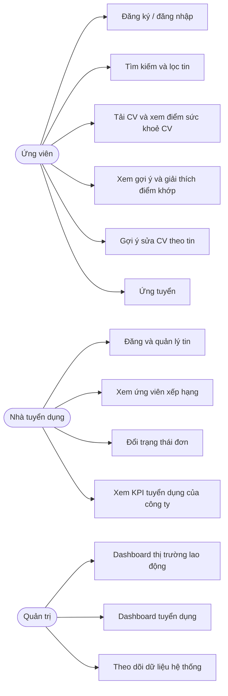

# Yêu cầu và thiết kế hệ thống

> File này được sinh tự động bởi `scripts/gen_docs.py` từ `backend/db/schema.sql` và `docs/traceability.yaml`. Không sửa tay.

## 1. Bối cảnh và mục tiêu

Nền tảng kết nối tuyển dụng thông minh kết hợp BI và AI. Hệ thống (1) tự động khớp kỹ năng trong CV với yêu cầu của tin
tuyển dụng thành một điểm Matching Score có giải thích, (2) phân tích CV và chấm sức khoẻ CV, (3) cung cấp dashboard BI
về thị trường lao động cho quản trị viên và về hiệu quả tuyển dụng cho nhà tuyển dụng, (4) tối ưu quy trình tìm việc
bằng tìm kiếm, lọc, gợi ý top-K và gợi ý sửa CV.

## 2. Vai trò và use case

| Vai trò | Mô tả |
|---|---|
| Ứng viên (`candidate`) | Tạo hồ sơ, tải CV, xem gợi ý việc làm, ứng tuyển |
| Nhà tuyển dụng (`employer`) | Đăng tin, xem ứng viên xếp hạng theo điểm khớp, đổi trạng thái đơn, xem KPI công ty mình |
| Quản trị (`admin`) | Xem dashboard thị trường và tuyển dụng, theo dõi dữ liệu hệ thống |



## 3. Kiến trúc

Service: `postgres`, `backend` (FastAPI), `frontend` (Next.js), `superset`. Postgres là nguồn dữ liệu duy nhất; schema áp
dụng idempotent khi backend khởi động. ML dùng scikit-learn (TF-IDF, hồi quy logistic, random forest), không cần GPU.
Gemini chỉ phục vụ tính năng gợi ý sửa CV, có cache và fallback offline.


## 4. Thiết kế dữ liệu

Schema gồm **11 bảng** và **8 view** phục vụ BI (`v_skill_supply_demand`, `v_salary_by_segment`, `v_funnel`, `v_match_vs_outcome`, `v_skill_trend_quarter`, `v_skill_salary_premium`, `v_funnel_long`, `v_match_score_hist`). Đơn vị lương: triệu VND/tháng. `application.stage_reached` (0 nộp, 1 sàng lọc, 2 phỏng vấn, 3 offer) dùng cho funnel.

```mermaid
erDiagram
  company {
    serial id PK
    text name
    text location
    text industry
    text size
  }
  users {
    serial id PK
    text email
    text password_hash
    text role
    int company_id FK
    timestamptz created_at
  }
  job_posting {
    serial id PK
    text job_key
    int company_id FK
    text title
    text category
    text location
    text level
    numeric exp_years_min
    text education
    numeric salary_min
    numeric salary_max
    text description
    text requirements
    text source
    text status
    timestamptz posted_at
  }
  skill {
    serial id PK
    text name
    text aliases
    text type
  }
  job_skill {
    int job_id PK
    int skill_id PK
    numeric weight
  }
  candidate {
    serial id PK
    int user_id FK
    text full_name
    text major
    numeric gpa
    numeric exp_years
    text education
    text location
    numeric expected_salary
    boolean is_simulated
  }
  candidate_skill {
    int candidate_id PK
    int skill_id PK
    text source
  }
  cv_document {
    serial id PK
    int candidate_id FK
    text filename
    text raw_text
    jsonb parsed_json
    numeric health_score
    jsonb health_issues_json
    timestamptz created_at
  }
  application {
    serial id PK
    int candidate_id FK
    int job_id FK
    text status
     CHECK
    smallint stage_reached
    numeric match_score
    text source
    timestamptz applied_at
    timestamptz updated_at
    boolean is_simulated
  }
  matching_result {
    int candidate_id PK
    int job_id PK
    numeric score
    jsonb components_json
    text[] matched_skills
    text[] missing_skills
    text model_version PK
    timestamptz created_at
  }
  cv_suggestion {
    int cv_id PK
    int job_id PK
    jsonb content_json
    text source
    timestamptz created_at
  }
  company ||--o{ users : "company_id"
  company ||--o{ job_posting : "company_id"
  job_posting ||--o{ job_skill : "job_id"
  skill ||--o{ job_skill : "skill_id"
  users ||--o{ candidate : "user_id"
  candidate ||--o{ candidate_skill : "candidate_id"
  skill ||--o{ candidate_skill : "skill_id"
  candidate ||--o{ cv_document : "candidate_id"
  candidate ||--o{ application : "candidate_id"
  job_posting ||--o{ application : "job_id"
  candidate ||--o{ matching_result : "candidate_id"
  job_posting ||--o{ matching_result : "job_id"
  cv_document ||--o{ cv_suggestion : "cv_id"
  job_posting ||--o{ cv_suggestion : "job_id"
```

## 5. Truy vết yêu cầu

### Yêu cầu chức năng (FR)

| id | title | role | api | tables | page | test | status |
|---|---|---|---|---|---|---|---|
| FR01 | Đăng ký tài khoản ứng viên | candidate | POST /api/v1/auth/register | users, candidate | /auth/register | tests/test_api.py::test_register_login | done |
| FR02 | Đăng nhập | all | POST /api/v1/auth/login | users | /auth/login | tests/test_api.py::test_register_login | done |
| FR03 | Xem thông tin người dùng hiện tại | all | GET /api/v1/users/me | users, candidate, company | (header) | tests/test_api.py::test_me_requires_token | done |
| FR04 | Tìm kiếm và lọc tin tuyển dụng (từ khoá | candidate | GET /api/v1/jobs | job_posting, job_skill, skill, company | /jobs | tests/test_api.py::test_jobs_search | done |
| FR05 | Xem chi tiết tin tuyển dụng | candidate | GET /api/v1/jobs/{id} | job_posting, job_skill | /jobs/[id] | tests/test_api.py::test_job_detail | done |
| FR06 | Cập nhật hồ sơ ứng viên | candidate | PUT /api/v1/candidate/profile | candidate, candidate_skill | /profile | tests/test_flow.py::test_profile_update_recomputes | done |
| FR07 | Tải CV (PDF/DOCX) và trích xuất kỹ năng | candidate | POST /api/v1/cv/upload | cv_document, candidate_skill | /profile | tests/test_cv.py | done |
| FR08 | Chấm điểm sức khoẻ CV với 6 luật và báo lỗi cụ thể | candidate | POST /api/v1/cv/upload | cv_document | /profile | tests/test_cv.py::test_health_ordering_good_average_poor | done |
| FR09 | Gợi ý top-K việc làm theo Matching Score | candidate | GET /api/v1/recommendations | matching_result, job_posting | /recommendations | tests/test_flow.py::test_recommendations_sorted_with_reason | done |
| FR10 | Giải thích điểm khớp và kỹ năng còn thiếu | candidate | GET /api/v1/jobs/{id}/match | matching_result | /jobs/[id] | tests/test_matching.py | done |
| FR11 | Gợi ý sửa CV theo tin (Gemini | candidate | POST /api/v1/cv/suggest | cv_suggestion | /jobs/[id] | tests/test_flow.py::test_suggest_fallback_without_key | done |
| FR12 | Ước lượng lương theo phân khúc | candidate | GET /api/v1/salary/estimate | job_posting | /jobs/[id] | tests/test_flow.py::test_salary_estimate_shape | done |
| FR13 | Ứng tuyển và xem đơn đã nộp | candidate | POST/GET /api/v1/applications | application | /applications | tests/test_flow.py::test_employer_isolation | done |
| FR14 | Nhà tuyển dụng đăng và quản lý tin | employer | GET/POST /api/v1/employer/jobs | job_posting, job_skill | /employer/jobs | tests/test_flow.py::test_employer_isolation | done |
| FR15 | Xếp hạng ứng viên theo điểm khớp | employer | GET /api/v1/employer/jobs/{id}/candidates | application, matching_result | /employer/candidates | tests/test_flow.py::test_employer_isolation | done |
| FR16 | Đổi trạng thái đơn ứng tuyển | employer | PATCH /api/v1/applications/{id} | application | /employer/candidates | tests/test_flow.py::test_employer_isolation | done |
| FR17 | KPI tuyển dụng lọc theo công ty | employer | GET /api/v1/employer/kpi | application, v_funnel | /employer/dashboard | tests/test_flow.py::test_employer_isolation | done |
| FR18 | Dashboard thị trường lao động (cung-cầu kỹ năng | admin | GET /api/v1/market/stats | v_skill_supply_demand, v_salary_by_segment | Superset Dashboard A | superset/bootstrap_superset.py (verify_charts: mọi chart ≥1 hàng) | done |
| FR19 | Dashboard tuyển dụng (tỷ lệ chuyển đổi | admin | - | v_funnel, v_match_vs_outcome | Superset Dashboard B | superset/bootstrap_superset.py (verify_charts: mọi chart ≥1 hàng) | done |
| FR20 | Quản trị - số bản ghi | admin | GET /api/v1/admin/stats | job_posting, candidate, application | /admin/dashboard | tests/test_flow.py::test_admin_and_market_endpoints | done |

### Yêu cầu phi chức năng (NFR)

| id | title | api | tables | test | status |
|---|---|---|---|---|---|
| NFR01 | Postgres là nguồn dữ liệu duy nhất; backend không đọc file JSON nghiệp vụ | - | all | tests/test_flow.py::test_data_quality | done |
| NFR02 | Mật khẩu băm bcrypt | security.py | - | tests/test_api.py::test_me_requires_token | done |
| NFR03 | Upload an toàn - tên file uuid | routers/cv.py | - | tests/test_api.py::test_upload_rules | done |
| NFR04 | Chạy được không cần GPU và không cần khoá Gemini (fallback offline) | ml/cv_suggest.py | - | tests/test_flow.py::test_suggest_fallback_without_key | done |
| NFR05 | Điểm khớp tất định (cùng đầu vào cho cùng điểm) | ml/matching | - | tests/test_matching.py::test_deterministic | done |
| NFR06 | Độ trễ gợi ý p95 dưới 500ms | GET /api/v1/recommendations | - | ml/evaluate.py (latency) | done |

Tiến độ: **26/26** yêu cầu đã hoàn thành, còn lại ở trạng thái `planned` (phiên thi công ghi ở cột `phase` của `docs/traceability.yaml`).


## 6. Khác biệt so với thiết kế gốc

| Thiết kế gốc | Thực tế | Lý do |
|---|---|---|
| Lấy tin qua LinkedIn API / quét ATS | Dataset VietJobs công khai (HuggingFace), mẫu tối đa 5000 dòng | Không có quyền truy cập API; VietJobs là tin thật |
| Embedding + pgvector | TF-IDF + đặc trưng kỹ năng, hồi quy logistic | Không có GPU, tiết kiệm tài nguyên, dễ giải thích |
| Dữ liệu ứng viên thật | Ứng viên và đơn ứng tuyển mô phỏng (`is_simulated=true`) | Không có dữ liệu ứng viên công khai |
| Ngày đăng tin thật | `posted_at` mô phỏng (rải đều 12 tháng, seed 42); VietJobs không có cột ngày | Cần trục thời gian cho xu hướng lương; ghi rõ trong báo cáo |
| Công ty tuyển dụng thật | Công ty mô phỏng gán theo ngành | VietJobs không có cột công ty |
| Celery + Redis cho ETL định kỳ | Bỏ; ETL chạy tay bằng `python -m etl.load_jobs` | Giảm số service, không cần lập lịch trong phạm vi đồ án |
